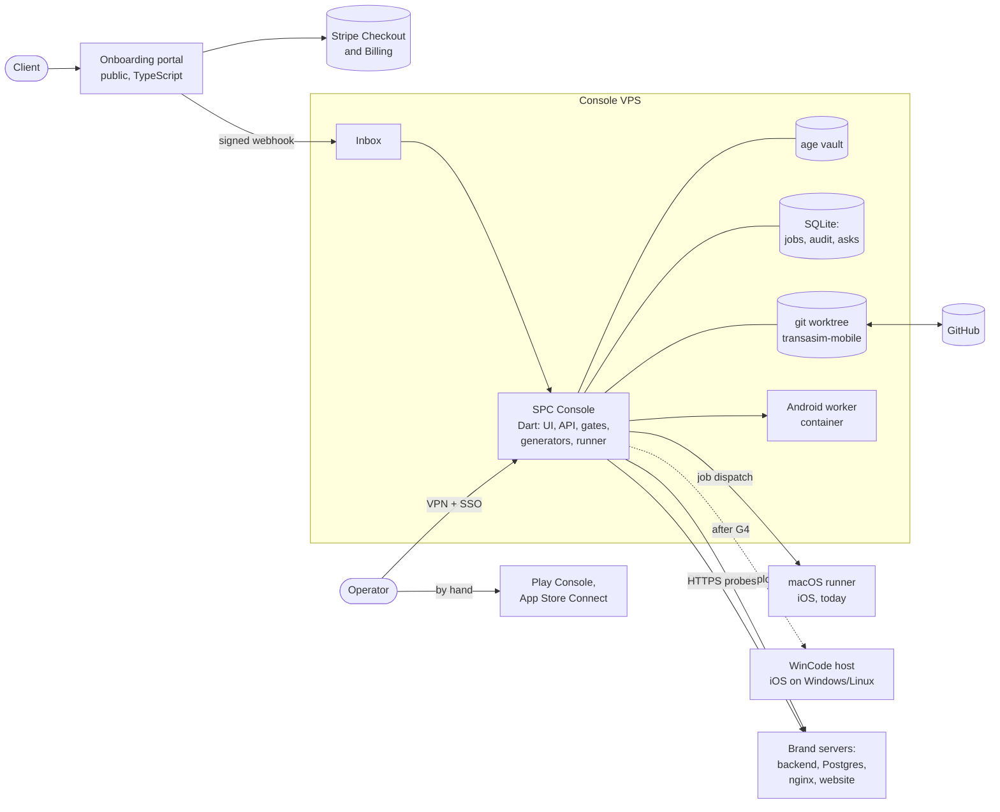
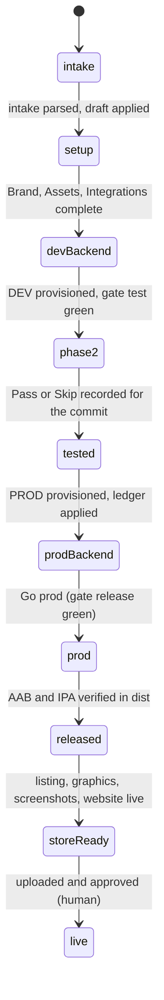

# SPC Console: the platform plan

Status: design, 2026-10-16. Alpha confirmed the understanding the same day and chose two of the
decisions below himself: the console reaches servers over SSH (D2), and each brand gets a
generated website (D3). Built so far: slice U (§11), and the first part of slice S (§9), 2026-10-17.

`docs/STUDIO-SPEC.md` stays the authority for what Studio is today. This file is the plan for what it
becomes. Where the two disagree, the spec describes the code in the repo, and this file describes the
target.

## 1. What we are building

One console that takes a new SPC from "we want an app" to "the app is in the stores":

1. **Onboarding.** The client signs up on the onboarding portal, picks a package and pays. Then they
   fill in what we need: brand, logo, colours, domains, legal texts, and access to their store
   accounts or we just upload them in unception our store apple and google.
2. **The brand.** The console receives the submission and creates the brand: Studio's New brand
   and intake, as today. It asks the client for whatever is missing.
3. **Servers.** It provisions the brand's backend, DEV then PROD, and the brand's website, on our
   servers over SSH.
4. **Builds.** It builds and verifies the Android app and the iOS app. iOS builds on a Mac runner
   for now, and through WinCode once WinCode passes its store gate.
5. **Store assets.** It prepares every store asset: texts, icon, feature graphic, screenshots and
   data safety answers. It stops before every store action; each one stays a human click.
6. **Live brands.** It keeps watching each live brand: probes, certificates, backups and
   incidents.

**Users.** Alpha operates the console, later with a small team. Clients only ever see the portal.

**Scale assumed.**
- 1 to 5 new brands a month, up to about 50 brands.
- About 10 builds a day.
- A handful of operators.

### What stays true

- `brand.json` is the only description of a brand. Generators are idempotent, and every write is
  shown before it happens (spec §1).
- Every server change is shown as a plan before it runs, like every Apply.
- No secret in git, logs, prompts, the Fix Bundle or the browser.
- Store uploads, Submit for Review and rollouts stay human (D11).
- Every incident becomes a rule the same day, in the one incident list.
- A release is refused unless its checks pass (`releaseRefusal`, `--verify-release`).
- Claude Code never reaches a server.

### What changes

The spec rules out "building a cloud service" (§1) and says Studio never connects to a server
(§13, §16.2). Both are reversed **for the console on the VPS, from slice P on** (D2). Until P
ships, Studio stays exactly as `CLAUDE.md` describes it.

## 2. Decision log

| # | Decision | Alternatives considered | Why |
|---|---|---|---|
| D1 | Studio's UI gets a light and a dark theme. Auto (follow the system) is the default, with a manual override per browser. | Dark only (as before); light only | The console is used all day, by clients later too. A console should respect `prefers-color-scheme`. |
| D2 | The console reaches servers over SSH. It logs in as a restricted deploy user and runs only fixed scripts. | An agent on each server that pulls signed jobs; a human runs printed commands, as today | Alpha's choice, 2026-10-16: the fastest to build, with no agent to maintain. Its cost is that whoever controls the console controls the servers. §5 is what limits that. |
| D3 | "Frontend per brand" means a generated static website: home, terms, privacy, account deletion, support, and the app-link files. | A web shop; both | The stores require the three legal pages, and Acorn waits on them today. App links need files on the brand's domain. A web shop is a later slice (A). |
| D4 | The console is Dart, grown from `tool/studio`. | A rewrite in Node or Next.js | Studio imports the app's own `BrandConfig`, so the app and the console share one parser. Generators, incidents, gates and redaction already exist, and are tested. |
| D5 | The operator UI stays plain HTML, CSS and JS, with no build step. | A React or Tailwind single-page app | It works offline, nothing needs building, and Claude Code edits it fast. The client portal is a separate TypeScript app anyway. |
| D6 | The admin side is reachable only over a private network (Tailscale or WireGuard), behind single sign-on with two factors. | Public, behind a login page | D2 makes the console the key to every server. A login page on the internet is the first thing attacked. |
| D7 | Secrets live in an age-encrypted store on the VPS, unlocked when the console starts. A secret is generated on the server when it can be (the database password, the JWT secret). | HashiCorp Vault or OpenBao; `.env` files | One VPS does not need a Vault cluster. A secret born on the server never crosses the console. |
| D8 | Git stays the source of truth for brand configuration. A SQLite database holds operational state: jobs, approvals, the audit log, asks, orders. | Everything in a database | The repo, its tests and its generators already treat `brands/` as data. SQLite is enough until there is more than one console node. |
| D9 | iOS store builds run on a macOS runner until WinCode passes its gate G4. WinCode is called through its CLI. | WinCode only; a Mac forever | WinCode's own plan keeps the Mac lane as the production default until Apple accepts its builds. |
| D10 | Clients pay through Stripe Checkout: a setup fee plus a subscription in Stripe Billing. | Invoices by hand | The business already runs on Stripe, and Checkout keeps card data off our servers. |
| D11 | No automatic store submission. Uploading to Play's internal track through the API is a separate decision, X (§9). | Full automation | Spec principle 4. A banned store account is the worst outcome the platform can cause. |
| D12 | In v1, client secrets (the Stripe secret key, Transatel and SMTP credentials) never pass through the portal: Alpha types them on the server with `spc-secret`. Later options are sealing them in the browser to the server's key, or Stripe Connect, which removes the client's secret key altogether. | A form field in the portal | The portal is public input, which is why the intake contract refuses secrets on purpose (spec §17). |

## 3. Architecture



| Component | Runs where | Owns | Built from |
|---|---|---|---|
| Console | A VPS of its own, Linux. Never a brand's PROD box. | The UI, API, runner, gates, vault, audit log | `tool/studio` |
| Onboarding portal | A public host | Sign-up, payment, the intake form, the status page | SPC-easy-submit |
| Android worker | A container on the console VPS (16 GB RAM) | `flutter build`, `--verify-release` | An image pinned to Flutter 3.47.3, JDK 21 and the SDK packages `CLAUDE.md` lists |
| iOS lane | GitHub macOS runners or a Mac mini; a WinCode host later | `build ipa`, export, verification | `ExportOptions` and an App Store Connect API key |
| Brand servers | The boxes in `servers.yaml`, as today | Backend jar, Postgres, nginx, certbot, the brand website | Provisioner scripts in `tool/studio/backend/` |
| Monitor | The console | DNS, TLS, health, packs, certificate expiry | `probes.dart`, run on a schedule |

## 4. The brand pipeline



| State | Done when | Who | Built by |
|---|---|---|---|
| intake | The submission is accepted and parsed | Client | Portal, `intake.dart` v2 (slice O) |
| setup | Brand, Assets and Integrations are complete, and Missing data is empty | Operator; the client answers asks | Studio's tabs (exist) |
| devBackend | The DEV backend is provisioned and gate `test` is green | Console over SSH | Slice P |
| phase2 | Go phase 2 | Operator | Exists |
| tested | Pass or Skip is recorded for this commit | Operator | Exists |
| prodBackend | PROD is provisioned, the schema ledger applied, the client's secrets set | Console and operator | Slice P |
| prod | Go prod | Operator | Exists |
| released | Android AAB and APK verified in `dist/`; iOS IPA verified | Console | Exists for Android; slice I for iOS |
| storeReady | Listing texts, graphics, screenshots and the data safety file are ready; the website is live with its three legal pages | Console, then the client approves | Slices S and L |
| live | Uploaded and approved by the stores | Human | Never automated (D11) |

Every transition writes an approval record: who, when, the commit and the brand hash.

## 5. Security model

**Threats, in order of likelihood:**
- a command run on the wrong box (it happened four times in the 4 October session);
- a secret leaking into a log or a paste;
- abuse of the public portal;
- the console itself being taken (D2 makes it the key to every server);
- a poisoned toolchain or dependency.

**Network.**
- The console binds to loopback, and Caddy terminates TLS in front of it.
- The admin side is reachable only through Tailscale or WireGuard.
- The portal runs on a separate host. The console accepts exactly one thing from it: signed webhooks
  on `/inbox`, each with an HMAC-SHA256 signature, a timestamp within 5 minutes and an idempotency
  key.

**Identity.**
- Operators sign in through single sign-on (Google sign-in restricted to listed accounts, through
  oauth2-proxy) or with passkeys.
- Every write still needs Studio's `X-Studio` header and a CSRF token.
- Roles: owner, operator, viewer.

**SSH, hardened (D2).**
- One key pair per server, generated by the console. The private half exists only in the vault.
- The `authorized_keys` line carries `from="<console IP>"` and `no-port-forwarding`,
  `no-agent-forwarding`, `no-X11-forwarding`, `no-pty`.
- The server user is `spc-deploy`: no password, and no interactive login. `sudo` reaches only
  `/opt/spc/bin/spc-*`, through a sudoers whitelist, and each script validates its own arguments.
- Each server's host key is pinned in `servers.yaml`, with `StrictHostKeyChecking yes`. A wrong box is
  refused before any command runs: the WRONG BOX rule moves into the transport.
- The console sends a job name and its arguments from a fixed catalogue, never a free command
  (Studio's rule today, in `jobs.dart`).
- Every remote run is logged, redacted, together with who approved it.
- **Kill switch:** one script that removes the console's line from `authorized_keys` on every server.
- **Upgrade path:** OpenSSH certificates valid for 10 minutes, signed per job. A stolen console disk
  would then hold no long-lived key.

**Secrets.**
- The vault is encrypted with age, and its key is loaded through a systemd credential at start.
- Secret fields are write-only in the UI: set, rotate, delete. A value is never shown again.
- `redact.dart` runs over every line that comes back over SSH, as it does over local jobs.
- A rotation date is recorded for each secret, so `bp-rotated` becomes a real check rather than a
  tick.

**Signing keys.**
- Upload keystores and the App Store Connect `.p8` key live in the vault.
- For a build they are copied into a tmpfs, and deleted when the build ends.
- Today a `.p8` key sits in `Documents/GitHub`, outside any repo. It moves into the vault when V1
  lands.

**Portal input.** Contract v2 keeps every refusal of spec §17: size caps, closed keys, the secret
scan, and no URL ever fetched.

**Backups.**
- Every night, the vault, SQLite and the `dist/` index are copied off-site, encrypted.
- Every night, each brand database is dumped off-box with `pg_dump`.
- A restore drill runs every quarter.

**Audit.** An append-only log of approvals, remote runs, secret changes and gate passes.

## 6. The provisioner (slice P)

The 9 steps of the backend runbook (`backend-onboarding-and-dev-to-prod-11-10.md`, outside the repo)
become scripts.

| Runbook step | Script | When it does nothing | Secrets |
|---|---|---|---|
| 0. Which box am I on? | The transport: pinned host key and `expectedHostname` | Refuses on a mismatch | None |
| 1. A free port | `spc-plan` reads `ss -tlnp` and takes the next free port in a range | The port is already in the state file | None |
| 2. `/apps/<slug>-backend` | `spc-apply layout` | The layout exists | None |
| 3–4. Database `<slug>_prod`, role, grants | `spc-apply db`: the schema from a versioned golden dump, plus the Liquibase rows | The database exists; it is never dropped | Password generated on the server into `conf/secrets.env` (mode 600) |
| 5. `application-prod.yml` | `spc-apply config`: rendered from a template, `secrets.env` and the brand's facts | The diff is empty | Stripe, Transatel and SMTP come from `spc-secret` (D12); the JWT secret is generated on the server |
| 6. Placeholders | The template refuses to render while a required secret is missing. `PENDING_` is allowed only for features that are off. | None | None |
| 7. Start and health | A systemd unit, `spc-<slug>.service`, which survives a reboot (today's `startup.sh` does not). Waits for `/management/health` to report UP. | Restarts only on a change | None |
| 8. nginx, DNS, TLS | `spc-apply web`: the vhost from a template and `nginx -t`. The domain must resolve to this box before certbot runs (Let's Encrypt rate limits). | The certificate exists | None |
| 9. Seed data | `spc-apply seed`: reference tables copied verbatim; business tables (`pack`, `price` and others) as a template flagged for review | The rows exist | None |
| After each step | Backups (`pg_dump` nightly, off-box), logrotate, and the checker | None | None |

The checker (`spc-backend-check.sh`) runs after every apply. Its JSON goes straight into the gate,
with no paste, through the same refusals as today: schema, WRONG BOX, age and secrets.

**Plan, then apply.**
1. `spc-plan <slug> <env>` prints a JSON plan, like `terraform plan`.
2. The console shows that plan as a previewed Apply.
3. `spc-apply` runs only the approved steps.
4. The checker runs, and the gates update.

**Never automated:**
- dropping a database or deleting a brand;
- restoring a backup over live data;
- rotating a live Stripe key.

**Jars.** Each backend release goes into the console's artifact store with its sha256 and commit,
and the provisioner copies that exact file. `bp-same-jar` then holds by construction.

**Test bed.**
- A scratch VPS (or a Multipass VM) is reset before each test run. A brand's real box is never the
  first place a script runs.
- The 2026-10-11 inventory fixtures stay the checker's tests.

## 7. The brand website (slice L)

- **Input.** It is generated from `brand.json` (name, colours, logos, support, legal identifiers),
  plus the client's own legal texts. Those arrive as Markdown in the intake, and are never written by
  us.
- **Pages:**
  - home: what the app does, the store badges once it is live, and support;
  - terms;
  - privacy;
  - account deletion: how to delete an account and what is kept. Until the backend has an endpoint,
    its form goes to the support address;
  - support.
  
  Every page has a light and a dark rendering (`prefers-color-scheme`).
- **App-link files.** `.well-known/assetlinks.json` (the package, plus the SHA-256 of the Play app
  signing and upload keys) and `.well-known/apple-app-site-association` (team id and bundle id). Both
  are generated from `studio.json`, so they always match the signing keys and
  `mobile.universalLinkHosts`.
- **Output.** `dist/<slug>/site/`: static files, no JavaScript needed.
- **Deploy.** The provisioner's web step serves the site from the brand's PROD box on the brand's own
  domain, through nginx and certbot.
- **Checks.**
  - Every legal URL in `brand.json` returns 200 and is the generated page.
  - The three legal pages exist before `storeReady`.

## 8. The iOS lanes (slice I, then W)

**The Mac lane: now, until WinCode passes G4.**
- The job `release-ios` runs on a macOS runner (GitHub Actions or a Mac mini registered as a worker).
- Its steps:
  1. `ruby tool/ios_flavors.rb`;
  2. `flutter build ipa --release --flavor <slug> --build-name <ios> --build-number <n>`;
  3. `xcodebuild -exportArchive`, signed with the App Store Connect API key
     (`-authenticationKeyPath`) instead of the Xcode account;
  4. the verification below;
  5. `dist/`.
- An upload to TestFlight would be one operator click, but only after decision X.

**The WinCode lane.** It starts with WinCode's phase 1 for internal builds, and its gate G4 for store
builds.
- **The call:**
  ```
  wincode build ipa --flavor <slug> -t lib/flavors/main_<slug>.dart \
    --build-name X --build-number N --export app-store --out <dir> --json
  ```
- **The result.** A JSON manifest: `ipa`, `sha256`, `bundleId`, `version`, `build`, `teamId`,
  `profile`, `assetsCar`, and `toolchain` (`flutter`, `xcodeXip`, `genSnapshot`). A failure exits
  non-zero with an error code from a fixed list, so the incident list can match it.
- **Studio never trusts the manifest alone.** `--verify-release-ios` unzips the IPA and checks:
  - the bundle id and the versions;
  - `CFBundleIconName` and `Assets.car`;
  - the team, bundle and type of `embedded.mobileprovision`;
  - the code signature's team;
  - only this brand's `flutter_assets`;
  - the 1024 icon, without alpha.
- **Where it runs.** On a Windows host with WSL2, today (WinCode ADR-0001). For the VPS, ask WinCode for
  a headless Linux mode: its toolchain is already Linux, and builds need neither the device link nor
  the GUI.
- **Legal.** Builds for clients on non-Apple hardware need a lawyer's review first. WinCode's own
  plan draws the same line.
- **Doctor.** It detects `wincode`, its version, and `wincode doctor --json`.

## 9. Store preparation (slice S)

This is the most valuable next slice. It runs entirely on this machine and needs no secrets.

**Play:**
- the 512 icon (the icon pipeline already renders it for eSimple);
- a 1024×500 feature graphic, generated from the brand's colours, full logo and tagline;
- phone screenshots at least 1080 px wide and at most 2:1, from an AVD at 1080×1920, with a scripted
  tour per locale. On 2026-10-16 Acorn's hand-made screenshots were 404×845 and refused.
- listing texts: a short one (80 characters at most) and a full one (4,000 at most). Drafted from
  `brand.json`, approved by the client in the portal.
- the data safety file for Play's "Import from CSV", from a per-brand declaration;
- the content rating (IARC) answers, kept as a checklist.

**Apple:**
- 6.9-inch screenshots (1320×2868);
- the App Privacy answers and the age rating;
- review notes naming the reviewer account. Its password goes in the vault, never in git.

**Output.** `dist/<slug>/store/<locale>/`, shown in a **Store** tab with a copy button per text. The
disabled "Checklist" tab becomes it.

**Decision X (later).** Upload the AAB to Play's internal testing track through the Android Publisher
API, with one operator click. Production stays in Play Console.

**Built, 2026-10-17** (`tool/studio/src/store.dart`, `tool/studio/web/store.js`,
`test/studio/store_test.dart`):
- The Store tab, after Build, in place of the disabled "Checklist" placeholder.
- **The Play icon:** the launcher's own render at 512 px.
- **The feature graphic:** 1024×500, no alpha.
  - The lockup and its ground are measured, not taken from the field names: the surface colour,
    then the primary, each with `logo.full` then `logo.fullInverse`, until a pair reaches 3:1.
  - A lockup without transparency sits on its own background.
  - Checked on all three brands: Acorn's mark on its light blue; Sabily's white lockup on its green,
    which would vanish on its cream surface; eSimple's white box on white.
- **Screenshot capture mode:** two jobs. One sets `wm size 1080x1920` and demo mode's status bar; the
  other undoes both, `adb -e` only.
- **Capture screen:** `screencap`, saved without alpha as `phone-NN.png`, and checked by `checkShot`.
  Acorn's six hand-made screenshots of 2026-10-16 are kept as a test of the refusal.
- **The live run**, 2026-10-17: Acorn's five phone screenshots (home, the store, a destination, a pack,
  the multi-country result), 1080×1920 RGB, from a profile build against production. Two things it
  showed:
  - On Android 16, demo mode's Wi-Fi needs `fully true`, or it draws a satellite icon in its place.
  - Socle bugs that every brand had: Home's title cut to one line, and dark status-bar icons on the
    destination page's dark header. Both fixed (`statusBarOver` in `app_theme.dart`).
  - Then fixed, the same day: the sign-in welcome's second title line under its sheet on a 16:9 phone
    (the badge now gives way), the packs sliding under the clock once the destination header has
    scrolled away (a strip in the page colour), and the raw backend pack names (titles are now the
    offer, "500 MB · 2 days": docs/APPROVALS.md).
- **Build for the store** (the `build-store` job): a profile APK with no `--dart-define`, so it talks to
  the backend brand.json names, then the launch steps. The first live run had used one made by hand.

**Not built yet:**
- the listing texts, which belong with onboarding v2, where the client writes and approves them;
- filling the data safety template per brand. `tool/studio/store/play-data-safety.csv` is Acorn's export of
  2026-10-18, in Play's own "Import from CSV" format (782 rows), with its two deletion URLs as
  `{accountDeletionUrl}` and `{dataDeletionUrl}`. A Store button that fills them from the brand and writes
  `dist/<slug>/store/` is next; the answers are Acorn's, so a brand without payments drops the financial rows;
- Apple's screenshot sizes;
- a scripted tour per locale.

## 10. Onboarding v2 (slice O)

**The portal:**
- client accounts, with an email magic link;
- the package and its price, paid through Stripe Checkout (setup fee and subscription);
- the intake form v2;
- uploads to object storage, each with its sha256;
- a status page per brand, and an inbox for asks.

**Contract v2** (`schemaVersion: 2`, additive to v1) adds:
- store listing texts, per language;
- store access confirmations:
  - Play: the operator invited as admin;
  - Apple: the operator added as App Manager;
  - Google Cloud: the operator added to the project;
- domains, with their DNS status;
- legal texts as Markdown, instead of Drive files;
- the client's approvals.

It still refuses any secret (spec §17).

**Transport.**
- The portal posts to `/inbox`: signature, timestamp and idempotency key.
- The console stores the raw submission and runs `intake.dart`. That creates a draft brand, which
  waits for the operator's Apply.
- Nothing polls Drive any more.

**Status back to the client.** The console publishes each brand's state, "what we need from you" and
the relevant links through a read-only endpoint. The portal polls it with its own key.

**Stripe.**
- `checkout.session.completed`, `invoice.paid` and `customer.subscription.deleted` update the order.
- An unpaid brand cannot reach `released`: payment is one more gate item, like any other.

## 11. Slice U: Studio's theme and guidelines (built 2026-10-16)

**Design read.** A dense operations console for one expert operator, later a small team. Its
language is calm and technical: the "press proof" of spec §4. It is built on native CSS tokens and
the IBM Plex it already serves, with no framework, because the spec rules out a build step. The
taste skill's landing-page rules do not apply to a console (its §13 says so). Its rules on contrast,
theming, colour and copy do. Dials: variance 3, motion 2, density 7.

- **Tokens.** Every colour in `studio.css` is a variable. The light set lives under
  `[data-theme="light"]`, and `color-scheme` follows the theme, so scrollbars and native controls match.
- **Mode.**
  - Auto (the system's setting) is the default; Light and Dark are the overrides.
  - The theme is set before the first paint, from `localStorage`.
  - On Auto, it follows a change of the system's setting live.
- **Contrast.** Every text token reaches at least 4.5:1 on the background, panel and field colours,
  in both themes. The dark theme's `--ink-3` was 3.9:1 and now passes; `test/studio/theme_test.dart`
  computes every pair, so a new token cannot regress it.
- **Guidelines.**
  - Every page opens with one line: what the page is for, and a **Next** button to the following
    step.
  - The Brand form shows one line for each field while that field has focus, linked with
    `aria-describedby`.
  - **Tips** in the top bar hides the guidelines and the field lines together.
- **Copy.** No en dash or em dash in visible text.

## 12. Roadmap

| Slice | What | Needs | Size | Done when |
|---|---|---|---|---|
| U | Theme and guidelines | None | Days | Both themes pass AA, every page has its guideline, the gates are green. **Done 2026-10-16.** |
| S | Store preparation, Android first | U | 1–2 weeks | Acorn's Play listing is completed from `dist/acorn/store` alone. **Graphics and screenshot capture built and run live 2026-10-17** (Acorn's icon, feature graphic and five screenshots); the data safety CSV and Apple's sizes remain (§9). |
| L | Brand website | S (shared assets) | 1–2 weeks | odysseysim.com's pages are generated and deployable, and the three legal URLs pass |
| V1 | The console on a VPS | None | 2–3 weeks | The operator signs in over the VPN, and an Acorn release built on the VPS passes every check |
| P | SSH provisioner | V1 | 3–4 weeks | A scratch brand goes from nothing to a DEV backend with health UP. The only hand steps are the bootstrap and `spc-secret`. |
| O | Onboarding v2 | V1, P | 3–5 weeks | A test client pays in Stripe test mode, and lands as a draft brand with its asks |
| I | iOS Mac lane | V1 | 2–3 weeks | Acorn's IPA is built on the runner and verified |
| W | WinCode lane | WinCode phase 1, then G4 | About 1 week per step | Studio calls `wincode build ipa`, and its IPA passes the verification |
| X | Store API uploads | A decision | 1–2 weeks | An internal-track upload, with an approval record |
| A | Later | None | None | Dark mode in the app (a dark palette per brand), Stripe Connect, a multi-tenant backend, a web shop |

**Order.** U and S are worth most now, need no server and no secret, and fix what blocked Acorn
today. V1 comes before P because the console must be locked down before it holds any server key.

## 13. Non-functional requirements (assumptions until measured)

- **Performance.**
  - A cold Android release build takes 19 to 20 minutes, a warm one about 7.5 (spec §6). One build at
    a time per worker.
  - The console's pages answer reads in under 200 ms.
- **Reliability.**
  - The live brands do not depend on the console: their backends run on their own boxes. A console
    outage stops builds and provisioning, never sales.
  - The console can be rebuilt from git and the vault backup in under an hour. Its database can lose
    at most one day.
- **Maintenance.**
  - One operator, with Claude Code.
  - Every new failure becomes an incident file with its examples. Every new console step becomes a
    guide.
- **Privacy (GDPR).**
  - Hosting stays in the EU.
  - The console holds the client's business data. End users' data stays on the brand backends.
  - Logs mask e-mail addresses (`redact.dart`).
  - Each client gets a data processing agreement.

## 14. Risks

| Risk | Mitigation | Kill switch |
|---|---|---|
| The console is taken (D2) | The VPN, single sign-on, per-server keys restricted by source IP and command, certificates later | The key-revocation script (§5) |
| A command on the wrong box | Pinned host keys, plus the hostname check | The transport refuses |
| Apple's licence terms and WinCode | The Mac lane stays the default; a lawyer's review | Keep store builds on the Mac lane |
| A store bans an account for automation | No submission is automated (D11) | Not needed |
| Scope: about four months for one person with Claude Code | Each slice ships on its own and leaves Studio usable | Stop after any slice |
| The backend code lives outside this repo | Versioned jars, and a config template agreed with the backend developer | Hand deploy stays possible |
| Liability for legal texts | The client supplies and approves them; we only host them | Not needed |

## 15. Open questions for Alpha (defaults in brackets)

1. **Private network:** Tailscale or plain WireGuard? [Tailscale: quickest, and free at this size]
2. **The console's VPS:** a new one, or an existing box? [A new one: never a brand's PROD box]
3. **Android builds:** on the console VPS, or a second build VPS? [The console VPS, with 16 GB of RAM]
4. **DNS:** which provider holds `transasim.com`, and does it have an API for `<slug>.transasim.com`
   records? [Ask]
5. **Backend jars:** where do they come from? [The backend's CI uploads each release to the console]
6. **Portal:** packages and prices. [A business decision]
7. **iOS:** GitHub's macOS runners, or a Mac mini? [GitHub runners first]
8. **Decision X:** allow Play internal-track uploads through the API? [Not before slices S and I have
   each been used twice by hand]
